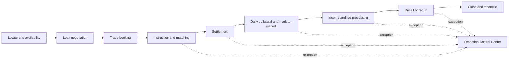

# Agency Lending Operations Case Study

A product and operations case study for a hypothetical enhancement to an agency securities-lending platform. It maps the trade lifecycle, defines exception-handling protocols, translates operational needs into requirements, and demonstrates SQL-based controls and UAT coverage.

> **Portfolio disclaimer:** This is an original, hypothetical case study built with synthetic examples. It does not describe a specific firm's systems, clients, controls, or confidential operating procedures.

## Problem

Agency-lending teams coordinate borrowers, beneficial owners, custodians, collateral venues, and internal operations across time-sensitive workflows. When instructions, settlement status, collateral, recalls, or fees diverge, teams can depend on manual reconciliation and fragmented follow-up. The result is avoidable settlement risk, slow exception resolution, and limited management visibility.

## Proposed enhancement

The **Exception Control Center** creates a shared operational queue that:

- Detects breaks using configurable business rules.
- Assigns an owner, severity, due time, and reason code.
- Preserves evidence and an auditable decision history.
- Escalates exceptions before market or contractual cutoffs.
- Provides lifecycle and control metrics to product and operations leaders.

## Repository contents

- [Case study](docs/CASE_STUDY.md) — context, discovery, scope, decisions, and success measures.
- [Lifecycle and workflows](docs/LIFECYCLE_AND_WORKFLOWS.md) — current-state map, target-state flow, and exception paths.
- [Operating protocols](docs/OPERATING_PROTOCOLS.md) — triage, ownership, escalation, evidence, and closure standards.
- [Product requirements](docs/PRODUCT_REQUIREMENTS.md) — functional and non-functional requirements with acceptance criteria.
- [Data and controls](docs/DATA_AND_CONTROLS.md) — conceptual model, control rules, and data-quality expectations.
- [SQL validation logic](sql/validation_checks.sql) — illustrative checks for settlement, collateral, recalls, fees, and stale exceptions.
- [UAT plan](docs/UAT_PLAN.md) — test approach, entry/exit criteria, scenarios, and traceability.
- [Runnable SQLite controls](sql/runnable_demo.sql) — schema, synthetic records, and executable control views.
- [Interactive dashboard source](dashboard/) — responsive Sites application for exception triage.
- [Offline dashboard](offline/index.html) — self-contained edition requiring no installation or internet connection.

## Dashboard editions

| Edition | Use case | Access |
|---|---|---|
| Hosted dashboard | Portfolio demonstration and sharing | [Open hosted site](https://agency-lending-exception-center.eskstrom.chatgpt.site) |
| Offline dashboard | Interviews, travel, or restricted networks | Download and open `offline/index.html` |
| Local development | Extend or customize the product | Run the application in `dashboard/` |

All editions use hypothetical workflows and synthetic records. No confidential or production data is included.

## Lifecycle at a glance

## Product principles

1. **Detect early:** surface a risk before a cutoff is missed.
2. **Make ownership explicit:** every open exception has one accountable owner.
3. **Keep humans in control:** automation recommends and routes; authorized users decide.
4. **Retain evidence:** status changes, overrides, communications, and approvals are auditable.
5. **Measure outcomes:** optimize for reduced risk and handling time, not queue activity alone.

## Key success measures

| Measure | Illustrative target |
|---|---:|
| Exceptions detected before cutoff | >= 95% |
| High-severity exceptions with an owner in 5 minutes | >= 98% |
| Median time to resolution | 30% reduction |
| Aged exceptions beyond SLA | 50% reduction |
| False-positive alert rate | < 5% |
| Closed exceptions with complete evidence | 100% |

## Assumptions

- Dates, thresholds, service levels, and field names are illustrative.
- The design is market- and venue-agnostic; production rules would require legal, compliance, tax, credit, and operations approval.
- SQL uses broadly PostgreSQL-compatible syntax and a simplified conceptual schema.

