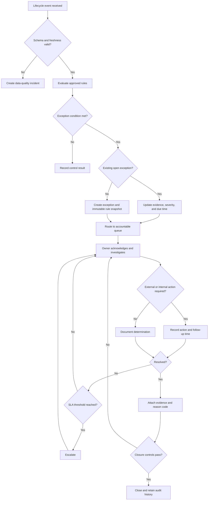
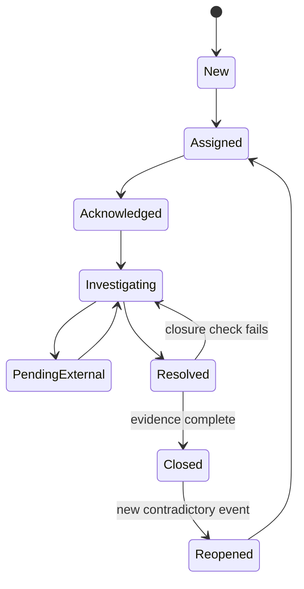

# Lifecycle and Workflows

## End-to-end lifecycle

| Stage | Primary event | Key control | Common exception |
|---|---|---|---|
| Locate and availability | Inventory identified | Availability and restriction check | Inventory no longer available |
| Negotiation | Terms agreed | Counterparty, limit, and term validation | Terms outside approved parameters |
| Booking | Loan captured | Required fields and duplicate check | Missing or duplicate booking |
| Instruction and matching | Settlement instruction sent | SSI and economics match | Unmatched or mismatched instruction |
| Settlement | Securities/cash movement confirmed | Expected vs. actual settlement | Partial or failed settlement |
| Collateral and mark-to-market | Exposure and requirement recalculated | Coverage and eligibility control | Deficit, concentration, stale price |
| Income and fees | Accrual/payment calculated | Rate, balance, currency reconciliation | Fee or manufactured-payment break |
| Recall and return | Return requested/received | Due-date and quantity tracking | Overdue or partial recall |
| Close and reconcile | Balances reduced to zero | Position, cash, and fee reconciliation | Residual balance or orphan event |

## Target-state exception flow

## Exception state model

## Five MVP exception paths

### Unmatched instruction

Trigger when a sent instruction remains unmatched past its configured tolerance or economics differ on a matched record. Enrich with market, security, quantity, counterparty, intended settlement date, match status, and cutoff. Close after a confirmed match or an approved cancellation is evidenced.

### Settlement fail

Trigger when the settled quantity is below the expected quantity after the relevant checkpoint. Severity increases with approaching cutoff, fail age, materiality, recall linkage, and client impact. Close after full settlement, approved cancellation, or authorized adjustment.

### Collateral deficit

Trigger when eligible collateral value falls below the requirement after approved haircuts and tolerances. Preserve calculation timestamp and input lineage. Close only when a subsequent authoritative calculation demonstrates sufficient coverage or an authorized override is approved.

### Overdue recall

Trigger when recalled quantity remains outstanding after the due time. Highlight partial returns and approaching downstream delivery obligations. Close when the recalled quantity is fully returned or the recall is amended/cancelled with authorization.

### Fee discrepancy

Trigger when expected and reported accruals differ above absolute or percentage tolerance. Group related daily breaks to avoid alert multiplication. Close following correction, documented timing difference, or approved write-off path.

